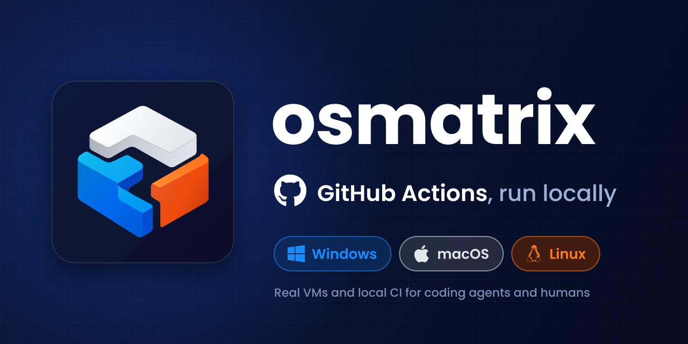

# osmatrix

[](https://github.com/fritz-fritz/osmatrix/actions/workflows/ci.yml)
[](https://www.npmjs.com/package/osmatrix)
[](https://skills.sh/fritz-fritz/osmatrix)
[](LICENSE)
[](https://socket.dev/npm/package/osmatrix)

<p align="center"></p>

Local **Ubuntu, Windows and macOS** environments plus **local GitHub Actions matrix runs** for coding agents (Claude Code, Cursor, Codex) and for humans. It's one CLI that also serves as an MCP server, and it ships with three agent skills.

- **Guests**: `exec`, file push/pull, **port forwarding** (both directions), screenshots and keyboard/mouse input.
- **Local CI**: `ci plan` / `ci run` expand workflow matrices. `ubuntu-*` legs run with [act](https://github.com/nektos/act) on the host's Docker. `windows-*` and `macos-*` legs run act **inside** the matching VM, so a Windows leg really runs on Windows.
- **Cross-platform hosts**: Linux, Windows (WSL2) and macOS; see the [compatibility matrix](#compatibility-matrix). Guests this host can't run can be any machine you can reach over ssh.

```
Claude Code / Cursor / Codex
  ├─ skills (SKILL.md ×3): when and how
  └─ MCP server (osmatrix mcp, stdio) ─┐
human / scripts ── osmatrix CLI ───────┴─ core ─┬─ ubuntu  : act runner image + sshd (container)
                                               ├─ windows : dockur/windows VM (KVM) | QEMU+HVF (Apple Silicon)
                                               ├─ macos   : dockur/macos VM (KVM) | tart (Apple Silicon)
                                               └─ any     : existing machine over ssh
```

## Install

### As an agent plugin (recommended)

The repository is a plugin marketplace for each client, and its root is the plugin. The plugin bundles the skills and the MCP server, which runs from npm as `npx -y osmatrix@0 mcp`, pinned to the current major version.

| Client | Install |
|---|---|
| Claude Code | `/plugin marketplace add fritz-fritz/osmatrix`, then `/plugin install osmatrix@fritztech` |
| Codex / ChatGPT | `codex plugin marketplace add fritz-fritz/osmatrix`, then enable **osmatrix** under Plugins |
| Cursor | **Dashboard → Plugins → Team Marketplaces → Add Marketplace → Import from Repo** |
| Skills only, any agent (via [skills.sh](https://skills.sh)) | `npx skills add fritz-fritz/osmatrix` |

Requirements:

- Node.js 22.18+ with npm.
- Docker.
- KVM for the Windows/macOS VMs; on Apple Silicon, QEMU for Windows and tart for macOS (see the [compatibility matrix](#compatibility-matrix)).

The plugin adds three skills, so an agent loads only the guidance a task needs:

| Skill | Loads when the task is... |
|---|---|
| `osmatrix-ci` | running a repo's GitHub Actions workflows locally, debugging a leg that failed on another OS |
| `osmatrix-guests` | running or debugging code inside a Ubuntu/Windows/macOS guest, reaching a guest app from the host (port forwarding), driving a VM's GUI |
| `osmatrix-setup` | first use, checking the host, creating or repairing guests, adding an ssh guest |

Then try: "Check which operating systems this host supports, then plan this repository's CI." Planning starts no guests. For repository tools, the agent passes your checkout's absolute path explicitly.

> If the osmatrix MCP server shows as failed after you install or switch plugins, toggle it off and on in your client's MCP settings. Some clients, Cursor for one, remember a server's failure by name even across reinstalls.

### As a CLI (npm)

```bash
npm install -g osmatrix
osmatrix init                  # config + ssh key + host check
osmatrix install-agents        # optional: register MCP server + skills with Claude Code, Cursor and Codex without the plugins
```

`install-agents` writes to these places:

- **Claude Code**: `claude mcp add --scope user`, or `~/.claude.json` when the `claude` CLI isn't on PATH. Also `~/.claude/skills/osmatrix-*`.
- **Cursor**: `~/.cursor/mcp.json`, plus the shared `~/.agents/skills/osmatrix-*`.
- **Codex**: `~/.codex/config.toml` `[mcp_servers.osmatrix]`, plus the shared `~/.agents/skills/osmatrix-*`.

A single `osmatrix` skill installed by an earlier version is removed, so it doesn't trigger next to the new ones.

Options:

- `--claude`, `--cursor` or `--codex` limits it to one agent.
- `--npx` registers `npx -y osmatrix@<major> mcp` instead of the local path.
- `--dry-run` previews the changes.
- `--uninstall` removes them.
- A backup of every file it edits is written next to it as `*.osmatrix.bak`.

## Host requirements

### Compatibility matrix

| Host | ubuntu | windows | macos |
|---|---|---|---|
| Linux x86_64 + KVM | ✅ container | ✅ dockur: Windows Server 2025 | ✅\* dockur: macOS 15 (Intel) |
| Linux arm64 + KVM | 🧪 container | 🧪 dockur: Windows 11 on ARM | ❌ |
| Windows 11 x86_64 + Docker Desktop (WSL2 with nested virtualization) | 🧪 container | 🧪 dockur: Windows Server 2025 | 🧪\* dockur: macOS 15 (Intel), best effort |
| Windows 11 arm64 | 🧪 container | ❌¹ | ❌ |
| macOS Apple Silicon | 🧪 container | 🧪 QEMU + Hypervisor.framework: Windows 11 on ARM | 🧪\* tart |
| macOS Intel | 🧪 container | ❌ | ❌ |

- ✅ supported and tested. 🧪 supported by the code but not yet tested on that kind of host (CI covers install, the MCP server and planning on Windows and macOS, but GitHub's runners can't start guests there); please tell us how it went with a [compatibility report](https://github.com/fritz-fritz/osmatrix/issues/new?template=compatibility.yml). `osmatrix report <guest> --outcome works|partly|fails` fills one in (sanitized, sends nothing), and agents offer to file one, with your consent, when a result differs from this matrix (an untested combination either way, or a tested one that fails). ❌ not possible on that host.
- Any cell marked ❌ can still be served by an `ssh` guest: an existing machine you can reach over ssh (see [Configuration](#configuration)).
- \* **macOS guests are licensed only on Apple hardware.** Apple's [macOS Software License Agreement](https://www.apple.com/legal/sla/) permits macOS virtual machines only on Apple-branded computers, so only the Apple Silicon row is within the licence. On other hosts the dockur macOS guest works technically, but running it is outside Apple's terms; osmatrix asks you to accept the licence before installing it (below).
- ¹ dockur needs KVM inside Docker, which Docker Desktop on Windows on ARM doesn't provide.
- macOS guests on arm64 Linux or Windows hosts aren't possible: Apple Silicon macOS only virtualizes on Apple hardware, and the Intel macOS image is x86_64-only (emulating it is 14–27x slower than KVM in our measurements).

On Apple Silicon, the Windows guest runs on the Mac's own QEMU (`brew install qemu`) with Hypervisor.framework. Docker is still needed once: setup runs dockur's `windows-arm` image to download Windows 11 on ARM and build the unattended install media, then boots them with the host's QEMU. The guest is Windows on ARM, so x64-only tools run under Windows' own emulation; osmatrix installs native ARM64 builds of PowerShell, Git, Node.js, Python and act.

Run `osmatrix doctor` to see what this host can do. It also needs an OpenSSH client and `tar`, both built into current Windows, macOS and Linux. `act` is downloaded (checksum-verified) on first use if it isn't on PATH.

> **macOS licensing\*:** installing a macOS guest accepts Apple's [macOS Software License Agreement](https://www.apple.com/legal/sla/), which only permits macOS on Apple hardware. osmatrix asks for this consent once, through `osmatrix setup macos --accept-license` or an agent's `env_setup` call with `accept_license` after you agree, and records it as `macos_eula_acknowledged = true`.

### Guest resources

| Guest | CPUs (min / default) | RAM (min / default) | Virtual disk (min / default) | Host disk once set up |
|---|---|---|---|---|
| ubuntu (container) | 1 / unlimited | 1G / unlimited | none | the act image |
| windows: Server 2025, x86_64 | 2 / 4 | 4G / 8G | 40G / 64G | ~12G (measured), plus the install ISO (~6G) during first setup |
| windows: Windows 11 ARM | 2 / 4 | 4G / 8G | 64G / 64G | ~20G (estimate) |
| macos: dockur (Intel) | 2 / 4 | 4G / 8G | 48G / 64G | ~25G (measured) |
| macos: tart | 2 / 4 | 4G / 8G | from the image (50G) | ~25G (estimate) |

- VM disks are sparse: the host only stores what the guest has written. Each VM's golden snapshot is another copy (less on copy-on-write filesystems such as btrfs).
- Each running VM holds its full RAM. Running Windows and macOS together at the defaults takes 16G for the guests alone, so plan on 24G or more of host RAM; on a 16G host, run one VM at a time (`max_vms = 1`).
- The minimums are what the OS and osmatrix's provisioning still work with. Builds go faster with the defaults or more.

Change a guest's size with `osmatrix configure` (MCP: `env_configure`). It checks the new values against the minimums and what the host has:

```bash
osmatrix configure windows --memory 12G --cpus 6          # takes effect at the next start
osmatrix configure windows --disk 96G --apply             # dockur VMs only: restart now; the partition grows to fill the disk
```

`disk` applies to dockur VMs (Windows and macOS on Linux/Windows hosts); tart and the Apple Silicon QEMU guest keep their image's disk size. Disks can only grow. After a disk grows, osmatrix extends the system partition on the next boot. On Windows that removes the Recovery partition that sits after C:, and Windows RE moves onto C:.

### Devcontainers, Codespaces and remote Docker

osmatrix expects to run on the machine that runs Docker. Each local guest is a container. osmatrix reaches it over ssh on a port that Docker publishes on `127.0.0.1`, and the Windows guest receives its unattended-install files through a bind mount of a directory in the osmatrix data dir. Both of those only work when the Docker daemon shares osmatrix's loopback and filesystem.

Inside a devcontainer or Codespace, that depends on how the container gets Docker:

| Setup | Daemon shares loopback / files | ubuntu guest | Windows / macOS VMs | Linux CI legs | `ssh` guests |
|---|---|---|---|---|---|
| No Docker in the container | — | no | no | no | yes |
| **Docker-in-Docker** (a daemon inside the container, e.g. the `docker-in-docker` feature) | yes / yes | yes | only if `/dev/kvm` is passed into the container (never on Codespaces) | yes | yes |
| **Docker-outside-of-Docker** (the host's socket mounted in, e.g. the `docker-outside-of-docker` feature) | no / no | refused | refused | yes, with caveats | yes |
| Remote `DOCKER_HOST` (`tcp://`, `ssh://`) | usually no / no | refused | refused | yes, with caveats | yes |

What goes wrong with Docker-outside-of-Docker:

- **Ports.** `-p 127.0.0.1:2221:22` binds the *host's* loopback. The devcontainer has its own network namespace, so its `127.0.0.1:2221` has nothing listening, and ssh to the guest never connects. The guest would look like it was booting forever.
- **Paths.** A bind mount names a path, and the daemon resolves it on the *host's* filesystem. The Windows guest's install folder (`~/.local/share/osmatrix/guests/windows/oem` inside the devcontainer) doesn't exist there. Docker would mount an empty directory, and Windows would spend 20–60 minutes installing without the script that enables ssh.
- **Linux CI legs** still work, because act copies the checkout into its job containers instead of mounting it. Steps can still fail if they upload or download artifacts or use the actions cache, which reach back to act's servers in the devcontainer, or if they bind-mount host paths themselves.

`osmatrix doctor` (MCP: `host_doctor`) detects devcontainers (`REMOTE_CONTAINERS`, `DEVCONTAINER`), Codespaces (`CODESPACES`), other containers (`/.dockerenv`, `/run/.containerenv`) and remote `DOCKER_HOST` values. In those cases it probes the daemon: it bind-mounts a marker file and publishes a port on `127.0.0.1`, then checks that both are visible from where osmatrix runs. It reports the result under `nesting`: `container` (which kind, and why it thinks so), `dockerHost` (a remote daemon) and `docker.{files,loopback}`. When the probe shows a local guest can't work, `up`, `setup` and CI legs on that guest fail straight away with the reason, rather than hanging. The same happens when the probe itself can't run, for example if busybox can't be pulled, because reachability is then unknown. A failed probe is retried on the next call. On a plain host, none of this runs.

**What works well from a devcontainer:** `ssh` guests. They need only an ssh client, so a real Windows PC or Mac, or a Linux box, configured as an `ssh` guest (see [Configuration](#configuration)) gives you `exec`, `push`/`pull`, port forwarding and CI legs from anywhere. Forwards land on the devcontainer's loopback, where your editor's port forwarding can pick them up. If you want local VMs, run osmatrix on the Docker host itself.

## Setting up guests

Guests are disposable development VMs, so `osmatrix setup <guest>` makes every choice for you. It installs the OS, creates the user, enables SSH, sets up passwordless sudo, installs the toolchain and saves a golden snapshot. You don't take any steps yourself, apart from the macOS license consent above.

```bash
osmatrix setup ubuntu                       # seconds
osmatrix setup windows                      # ~20-60 min on first run
osmatrix setup macos --accept-license       # ~30-60 min on first run
osmatrix status                             # progress shows up as setup.phase
```

Agents use `env_setup` and poll `env_status`. Afterwards, `osmatrix reset <guest>` brings a guest back to the golden snapshot in seconds.

How each guest gets there:

- **ubuntu**: a container built from `catthehacker/ubuntu:act-24.04` with sshd added.
- **windows**: dockur downloads Windows Server 2025 (evaluation) from Microsoft and installs it unattended. [`provision.ps1`](assets/oem/windows/provision.ps1) installs PowerShell 7, Git, Node LTS, Python and act, then enables sshd. Its log is at `C:\OEM\provision.log`.
- **macos (dockur)**:
  1. osmatrix boots macOS Recovery. It drives Recovery's Terminal through the VNC display and a small [command bridge](assets/macos/bridge.py) inside the container, erases the disk, and runs `startosinstall --agreetolicense`.
  2. After the install it boots Recovery again and runs [`configure.sh`](assets/macos/configure.sh) on the new system. That creates the `osmatrix` admin user with the SSH key, Remote Login, passwordless sudo and auto-login, and skips Setup Assistant.
  3. Finally [`macos.sh`](assets/provision/macos.sh) installs the Xcode command-line tools, Node, Python and act, and creates `/Users/runner/hostedtoolcache`, where the macOS packages behind `actions/setup-python` and similar actions install on GitHub's runners.

  These guests are Intel (x86_64), so they have no Homebrew; Homebrew dropped Intel support.
- **macos (tart)**: clones a cirruslabs image, installs the key through the guest agent, then provisions with Homebrew.

The generated guest passwords are stored in the osmatrix data dir under `guests/<name>/credentials.json`, for RDP or the VNC viewer.

## Everyday use

```bash
osmatrix status
osmatrix exec windows -- 'Get-ChildItem env: | Select -First 5'
osmatrix push windows ./myrepo            # -> ~/work/myrepo (respects .gitignore)
osmatrix forward windows 3000             # app in the guest on :3000 -> http://127.0.0.1:3000 on the host
osmatrix forward macos --reverse 5432     # host Postgres reachable inside the guest at 127.0.0.1:5432
osmatrix screenshot windows -o shot.png

osmatrix ci plan                          # legs, targets, warnings; runs nothing
osmatrix ci run --only windows -m node=22 # background run; poll with:
osmatrix ci status
osmatrix ci logs test-windows --tail 100
osmatrix ci run --wait                    # foreground, exit code reflects the result
```

Secrets for CI go in `<repo>/.osmatrix/secrets` (or `.secrets`) as `KEY=value` lines. Run logs land in `<repo>/.osmatrix/runs/`, which is git-ignored automatically.

## Configuration

`osmatrix config` prints the effective config and its file path. See [skills/osmatrix-setup/references/reference.md](skills/osmatrix-setup/references/reference.md) for every option, including adding `ssh` guests such as a real Mac on your network.

## What local runs don't reproduce

`ci plan` warns about each of these:

- `services:` on non-Linux legs.
- OIDC.
- `needs:` across OSes. act runs the dependency in the same environment; on Windows legs, osmatrix runs a needed Linux job's `run:` steps without a `shell:` with Git Bash. It does that in a derived copy of the workflow outside the guest's synced tree, which osmatrix leaves untouched.
- Matrices built from expressions.
- Remote reusable workflows.

act also keeps the file-command files (`GITHUB_OUTPUT`, `GITHUB_ENV`, …) outside `RUNNER_TEMP`, so scripts that check those paths stay inside `RUNNER_TEMP` fail only locally. A failed leg says so in its warnings; skip such checks when `env.ACT` is set.

Guests are also leaner than GitHub's hosted images, so prefer `setup-*` actions.

## Privacy and terms

osmatrix runs on your machine, with no telemetry or accounts, and does not independently transmit your data to FritzTech. See [PRIVACY.md](PRIVACY.md) and [TERMS.md](TERMS.md). The Codex/ChatGPT listing links to both.

osmatrix is developed with AI coding agents under human review. [AI_POLICY.md](AI_POLICY.md) covers how the project uses AI, what's expected of AI-assisted contributions, and the rules for agents that file issues or pull requests for their users.

## Repository structure

```
osmatrix/                              # the repository root is the plugin, for every client
├── src/, assets/                      # the CLI + MCP server (npm package "osmatrix"); assets/logo.* is the plugin artwork
├── skills/osmatrix-{ci,guests,setup}/ # the skills, each self-contained (SKILL.md + references/)
├── .claude-plugin/                    # Claude Code: marketplace.json → ./, plugin.json
├── .cursor-plugin/                    # Cursor:      marketplace.json → ./, plugin.json
├── .agents/plugins/marketplace.json   # Codex:       marketplace    → ./
├── plugin.json, mcp.json              # Agent Plugins 1.0.0 manifest (Codex) and the MCP config all clients share
└── scripts/  sync-manifests.mjs, validate-skills.mjs, validate-plugins.mjs, package-plugins.mjs
```

Each client reads its own manifest at the root; `skills/`, `mcp.json` and the artwork are shared, so nothing is generated. After bumping the version in `package.json`, run `npm run sync`. CI runs `npm run validate`, which fails if a manifest version or the MCP pin has drifted, and checks every skill with the clients' own validators.

Nothing else at the root may use a name a client discovers as a plugin component: no `CLAUDE.md`, `bin/`, `commands/`, `agents/` or `hooks/`.

## Releasing

Every release is one immutable version. The tag is `v<x.y.z>`, matching `osmatrix@<x.y.z>` on npm. There are no moving git tags; "latest compatible" comes from npm's own version ranges:

| Spec | Resolves to |
|---|---|
| `osmatrix@0.1.0` | exactly that version (immutable) |
| `osmatrix@0.1` | the newest 0.1.x |
| `osmatrix@0` | the newest 0.x; the marketplace plugins run `npx -y osmatrix@<major> mcp` |
| `osmatrix@latest` | the newest stable release (prereleases publish under `next`) |

To release:

1. Bump the version with `npm version patch --no-git-tag-version` (or `minor` / `major`; a breaking CLI/MCP change means a new major), then run `npm run sync` to stamp it into the three plugin manifests and the major-version pin into their MCP configs.
2. Run `npm run verify` and `npm run release:rehearse`. The rehearsal runs `release.yml` locally as if `v<version>` had been pushed, with an `npm publish --dry-run` in place of attestation, publishing and the GitHub release (they need GitHub's OIDC token). It refuses a version that's already on npm, and ends with a preview of the release notes.
3. Commit and push `main`, and let GitHub CI run.
4. Run `npm run release:tag` (add `--wait` to wait for CI). It creates and pushes the tag only if `HEAD` is pushed, the version and tag are unused, and the commit's CI and other checks, such as CodeQL, have passed. So a tag isn't spent on a commit that can't be released.

When the tag lands, [`release.yml`](.github/workflows/release.yml):
   - checks again that the commit's CI and checks passed, waiting if they're still running; nothing irreversible happens before that;
   - validates, tests and builds the bundled plugins;
   - attests build provenance for the npm tarball and the plugin archives;
   - publishes that same tarball to npm with trusted publishing and provenance;
   - creates the GitHub release with all four files attached. Its notes are GitHub's generated list of merged PRs, grouped by label as set in [`.github/release.yml`](.github/release.yml); see "Pull requests" in [CONTRIBUTING.md](CONTRIBUTING.md#pull-requests) for how PRs get their labels.

If the checks fail after tagging, nothing has been published, so you can delete the tag, fix, and tag again.

One-time setup:
- In the GitHub repository settings, enable immutable releases.
- Trusted publishing can only be configured for a package that already exists. Claim the name once (a placeholder version is enough), then go to npmjs.com → osmatrix → Settings → Trusted publishing: publisher GitHub Actions, repository `fritz-fritz/osmatrix`, workflow `release.yml`, no environment, and "Allow npm publish". Every real version, including the first, then goes through the release workflow. Disallow token publishing afterwards.

## Contributing

Contributions are welcome under the MIT license; see [CONTRIBUTING.md](CONTRIBUTING.md).

## Development

```bash
npm ci
npm test          # unit tests (node:test, TypeScript run directly by Node)
npm run build     # tsc -> dist/
npm run validate  # skills, manifest versions, listing limits, assets and MCP commands
npm run check     # typecheck + tests + validate
npm run ci:local  # this repo's ci.yml via act: Linux on Docker, Windows/macOS in guests (ci:local:linux: Linux only)
npm run release:rehearse # release.yml for v<version>, publishing as a dry run
npm run release:tag # tag + push v<version> once the pushed commit's checks passed (maintainers)
npm run verify    # check + codeql + ci:local: run before pushing
npm run package:plugins # bundled Claude/Cursor/Codex plugins + local marketplace in artifacts/
npm run codeql    # GitHub's code-scanning queries, locally (needs the CodeQL CLI)
node src/cli.ts   # run from source
```

Set `OSMATRIX_HOME=/some/dir` to isolate config and state, for example in tests.

To use the checkout's CLI and MCP server directly, without packaging: `npm run build && npm link`, then `osmatrix install-agents`.

### Try unreleased changes as plugins

`npm run package:plugins` builds a plugin for each of Claude, Cursor and Codex that bundles this checkout's runtime, for trying changes that aren't released on npm yet. `artifacts/` is then a local marketplace named `fritztech-local` for all three clients, committed to its own git repo because Cursor imports marketplaces with git.

```bash
npm ci
npm run package:plugins
```

| Client | Install from `artifacts/` |
|---|---|
| Claude Code | `/plugin marketplace add ./artifacts`, then `/plugin install osmatrix@fritztech-local` |
| Codex | `codex plugin marketplace add ./artifacts`, then enable **osmatrix** under Plugins |
| Cursor | Add the local `artifacts/` folder as a marketplace (plugin cards may lack the logo for local marketplaces). If you switch from the npm-backed plugin, toggle its MCP server off and on. |

Each client's plugin is also archived as `artifacts/osmatrix-<client>-<version>.tar.gz` (one `osmatrix/` directory). Node.js 22.18+ and npm are required, and npx downloads runtime dependencies on first launch. Docker and virtualization requirements depend on which guests you use. Re-run `npm run package:plugins` after changes, then refresh the marketplace in your client.
